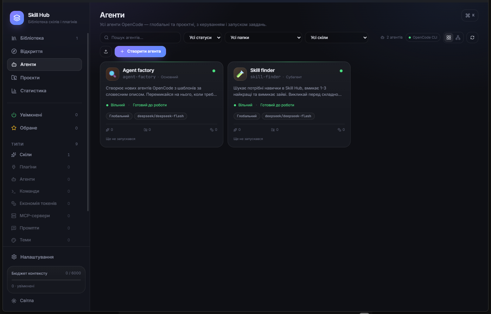

# Skill Hub

[](https://github.com/k0valyk/skill-hub/actions/workflows/ci.yml)

Локальна бібліотека скілів, плагінів, агентів і MCP-серверів для OpenCode — з аналізом GitHub-посилань, підключенням у один клік і власним MCP-сервером, щоб агент бачив **короткі описи**, а повний текст читав лише за потреби.

Windows-first десктоп: **Tauri 2 + Rust** (уся робота з диском, git, HTTP і секретами) та **React 19 + TypeScript + Vite + Tailwind 4 + Framer Motion + Lucide** (інтерфейс).

---

## Що вміє

- **Додавання за посиланням** — репозиторій, папка, окремий файл, gist або awesome-список. Спочатку **попередній перегляд**: що це, три речення (що / робить / навіщо), теги, ліцензія, зірки, розмір, ризики. Нічого не завантажується без підтвердження.
- **Класифікація** — правила за вмістом (SKILL.md, `opencode.json`, `agent/`, `command/`, MCP-маніфести, промпти, теми) + евристики за README, назвою й тегами GitHub.
- **Аналіз** — правила локально; якщо є ключ DeepSeek — 3-реченнєвий опис українською та англійською, кеш за версією промпта й комітом, лічильник токенів.
- **Безпека** — сканер підозрілих патернів (`curl | sh`, `eval`, читання `~/.ssh`, `process.env` + мережа, небезпечні postinstall), рівні `clean → high` і попередження в прев'ю.
- **Бібліотека** — сітка/список, пошук, фільтри за типом, обране, оцінки, нотатки, теги, дублікати, статистика, бюджет контексту.
- **Підключення до OpenCode** — junction-посилання `.opencode/skills/<id>` глобально або в конкретному проєкті; вимкнення прибирає лінк, файли в бібліотеці лишаються.
- **MCP-сервер `skillhub`** — `search_skills`, `get_skill`, `recommend`, `enable_skill`, `disable_skill`, `list_enabled`; ліниве завантаження й бюджет контексту.
- **GitHub** — вхід через Device Flow або personal access token, публікація проєктів з приватним режимом за замовчуванням, перевірка секретів і підтвердженням публічного пушу, синхронізація, бекап бібліотеки.
- **Профілі** — набори скілів під тип роботи, вмикаються одним кліком.
- **Оновлення** — перевірка нових комітів, ручне оновлення елемента, фонова перевірка раз на добу.
- **Агенти OpenCode** — окремий розділ з усіма глобальними й проєктними агентами, керуванням папками та скілами, запуском завдань, історією, токенами й вартістю.
- **Інтерфейс** — темна графітова тема за замовчуванням, світла опція, один акцентний градієнт (6 пресетів), скляний сайдбар, `Ctrl+K`, повага до `prefers-reduced-motion`, українська за замовчуванням з перемикачем на English.

---

## Агенти



Розділ читає `~/.config/opencode/agents` та `.opencode/agents` у проєктах (підтримує і старий `agent/`), парсить frontmatter OpenCode V2 і показує картки зі статусом, режимом, моделлю, дозволами, скілами й папками.

- **Живий статус** — вільний, працює, чекає підтвердження, помилка; рядок активності оновлюється з JSON-потоку `opencode run --format json`.
- **Завдання з картки** — вибір папки проєкту, авто-дозволи, скасування, історія з результатом, тривалістю, токенами й вартістю; таймаут 15 хв і кнопка «Повторити» для помилок.
- **Голос** — кнопка мікрофона в чаті, локальне розпізнавання Windows (SAPI), показ тексту перед відправкою, автовідправка, озвучення відповідей (Web Speech), кнопка зупинки, перемикач на кожного агента.
- **QA-цикл** — агенти `qa-tester` і `fixer` зі спільними звітами `reports/`, кнопка «QA цикл», до 5 кругів «тест → виправлення → повторний тест» з прогресом і підсумком.
- **Керування** — увімкнення/вимкнення (перейменування `.md` ↔ `.md.disabled`), зміна назви, опису, іконки (emoji або власне зображення), теги, видалення з підтвердженням.
- **Папки й скіли** — прив'язка проєктів (cwd для запуску) і скілів Skill Hub; скіли додаються у видимий блок у тілі агента, щоб він знав, що є в бібліотеці.
- **Створення** — локально з шаблону `agent-templates` або через агента `agent-factory`; є імпорт/експорт Markdown-файлу.
- **Вигляд** — сітка з анімаціями або карта зв'язків «агент → папки/скіли», пошук і фільтри за статусом, папкою та скілом.
- **OpenCode CLI** визначається автоматично з OpenCode Desktop (`%APPDATA%\\ai.opencode.desktop\\cli\\*`), з PATH або через `SKILLHUB_OPENCODE_CLI`.
- **Модель за замовчуванням** для агентів без власної моделі задається в Налаштуваннях (список береться з `opencode models`); на цій машині підключено `deepseek/deepseek-flash` через API-ключ DeepSeek.

### Голос

- **Ввід** — `voice_listen` запускає локальний розпізнавач Windows (SAPI) у фоні, тому аудіо не витрачає токени моделі й не блокує UI. Розпізнаний текст з’являється в полі завдання; можна редагувати або надіслати автоматично.
- **Мови** — залежать від мовних пакетів Windows: команда `voice_languages` показує встановлені. На цій машині є `en-US`; для `uk-UA`/`ru-RU` встанови мовний пакет у Windows Settings → Time & Language → Speech.
- **Відповідь** — озвучення через системний Web Speech: перемикач динаміка в шапці агента, зупинка окремою кнопкою. Код, таблиці, посилання й довгі списки не озвучуються.
- **Економний режим** (увімкнений за замовчуванням) — прибирає вставні слова/повтори з розпізнаного тексту й озвучує лише перші 2–3 речення; під полем показується оцінка токенів.

### QA-цикл

1. Поклади проєкт у папку (можна вибрати в модалці).
2. Натисни **QA цикл** → вибери кількість кругів (1–5).
3. `qa-tester` проходить тести й UI-сценарії та пише `reports/qa-report.json`; `fixer` виправляє critical/high, оновлює звіт і запускає тести.
4. Цикл зупиняється, коли відкритих critical/high немає, або після обраної кількості кругів. Прогрес, логи, лічильники й кнопка зупинки — у модалці.

---

## Запуск

Потрібні: **Node 20+**, **Rust 1.77+ (MSVC)**, **WebView2**, **git**.

```powershell
npm.cmd install
npm.cmd run tauri dev        # десктоп у режимі розробки
npm.cmd run tauri build      # інсталятори в src-tauri/target/release/bundle
npm.cmd run stage:cli        # зібрати CLI окремо (tauri build робить це сам)
```

Лише інтерфейс у браузері (без Tauri, на mock-даних):

```powershell
npm.cmd run dev
```

Тести:

```powershell
npm.cmd test                                        # vitest: фільтри, сортування, формат, голос
cargo test --manifest-path src-tauri/Cargo.toml     # Rust: правила, сортування, лікування, MCP
npm.cmd run qa:ui                                   # Playwright + Edge: вкладки, палітра, агенти, голос, QA-модалка
```

CLI живе в окремому крейті `skillhub-cli` (workspace поруч із GUI) і використовує ту саму бібліотеку:

```powershell
cargo build --manifest-path src-tauri/Cargo.toml -p skillhub-cli
# src-tauri/target/debug/skillhub-cli.exe
```

---

## CLI

```text
skillhub-cli [--root ПАПКА] <команда>

init                          створити структуру бібліотеки та просканувати
list [--json]                 список елементів
search <запит>                пошук по бібліотеці
enable <id> [--project ПАПКА] підключити до OpenCode
disable <id> [--project ПАПКА] відключити
budget                        бюджет контексту
connect [--project ПАПКА]     прописати MCP-сервер в opencode.json
check-updates                 перевірити нові коміти джерел
mcp                           запустити MCP-сервер (stdio)
version | --help
```

Приклад:

```powershell
skillhub-cli --root "$HOME\Documents\SkillHub" init
skillhub-cli --root "$HOME\Documents\SkillHub" search telegram
skillhub-cli --root "$HOME\Documents\SkillHub" enable telegram-bot-kit
```

Кнопка **«Підключити до OpenCode»** сама копіює CLI у `<root>/.skillhub/bin/skillhub-cli.exe` і прописує шлях у конфіг — окремо збирати нічого не треба. Під час `tauri build` CLI збирається й пакується поруч із застосунком (`bundle.externalBin`), тому інсталятор працює «з коробки».

---

## MCP в OpenCode

```json
{
  "$schema": "https://opencode.ai/config.json",
  "mcp": {
    "servers": {
      "skillhub": {
        "type": "local",
        "command": ["C:\\Users\\you\\Documents\\SkillHub\\.skillhub\\bin\\skillhub-cli.exe", "mcp"],
        "cwd": "~",
        "pool": true
      }
    }
  }
}
```

Саме такий запис додає кнопка «Підключити до OpenCode» у глобальний `~/.config/opencode/opencode.json` (або в `.opencode/opencode.json` проєкту). CLI бере корінь бібліотеки зі своїх налаштувань; якщо потрібен інший каталог — додай `"--root", "D:\\Skills"` у `command`.

Інструменти сервера:

| Інструмент | Призначення |
| --- | --- |
| `search_skills` | Пошук за темою/мовою/задачею; повертає id, назву, тип, одне речення, орієнтовні токени |
| `get_skill` | Повний текст скіла за id — лише коли справді потрібен |
| `recommend` | 3–5 скілів під описане завдання без завантаження тексту |
| `enable_skill` | Підключити глобально або в проєкті |
| `disable_skill` | Відключити, залишивши в бібліотеці |
| `list_enabled` | Що підключено і скільки це коштує в контексті |

Бюджет = сума описів увімкнених скілів + 14 токенів на кожен скіл (назва, тип і роздільники). Саме стільки OpenCode бачить у контексті; повний текст — «на вимогу».

---

## Структура бібліотеки

```text
Documents/SkillHub/
├─ library/
│  ├─ skills/  plugins/  agents/  commands/
│  ├─ token-savers/  mcp/  prompts/  themes/  other/
├─ projects/                 # локальні проєкти для публікації
├─ backups/                  # zip-бекапи
└─ .skillhub/
   ├─ skillhub.db            # метадані (SQLite)
   ├─ bin/skillhub-cli.exe   # CLI для MCP
   └─ cache/                 # тимчасові клони
```

Кожен елемент має `skillhub.json` з id, типом, джерелом, комітом, описами, тегами, ризиком і станом. Каталог можна змінити в **Налаштування → Коренева папка**.

---

## Налаштування

- **Корінь бібліотеки** — будь-яка папка; за замовчуванням `Documents/SkillHub`.
- **DeepSeek** — ключ зберігається у Windows Credential Manager (сервіс `SkillHub`). Без ключа описи генеруються правилами.
- **GitHub** — OAuth App з увімкненим **Device Flow**: встав `Client ID` у налаштуваннях і натисни «Увійти через GitHub». Альтернатива — personal access token зі scope `repo` (стабільніше для постійної роботи). Якщо в OAuth App увімкнено «Expire user access tokens», токен Device Flow живе ~8 годин і після цього потрібно увійти знову — застосунок поки не оновлює його автоматично.
- **Ліміт контексту** — повзунок у налаштуваннях; смуга бюджету показує, скільки описів уже зайнято.

Змінні середовища для тестів і CI:

| Змінна | Дія |
| --- | --- |
| `SKILLHUB_CONFIG_DIR` | Куди писати `settings.json` |
| `SKILLHUB_OPENCODE_DIR` | Який `opencode`-конфіг вважати глобальним |
| `SKILLHUB_GITHUB_TOKEN` | Перекриває токен із Credential Manager |
| `DEEPSEEK_API_KEY` | Перекриває ключ DeepSeek |

---

## Безпека

- Токени й ключі не потрапляють у фронтенд: усе живе в Rust і системному сховищі.
- Завантаження — лише після прев'ю; публічний пуш неможливий без явного підтвердження.
- Перед пушем проєкт сканується на схожі на секрети рядки; можна зупинитись або підтвердити вручну.
- Видалення елемента з диска — окремий чекбокс; за замовчуванням файли лишаються.

---

## Стан проєкту

Frontend і бекенд зібрані й проходять `tsc`, `vite build`, `vitest` (23 тести) і `cargo test` (44 тести). Перевірено наживо: аналіз реального репозиторію з DeepSeek, кеш описів, публікація приватного репо, бекап бібліотеки, `check-updates`, MCP over stdio, junction-підключення, розділ агентів і запуск завдань через OpenCode CLI (на реальному CLI та з тестовим CLI-заглушкою), голосове розпізнавання Windows, QA-цикл у браузерному mock-режимі, інсталятори MSI/NSIS. Деталі архітектури — у [ARCHITECTURE.md](ARCHITECTURE.md).

Що потрібно налаштувати вручну: `GitHub OAuth Client ID` або PAT (для GitHub-функцій) і ключ DeepSeek (для AI-описів). Усе інше працює локально без мережі, окрім GitHub-джерел і стрічки відкриттів.

---

## Ліцензія

MIT — див. [LICENSE](LICENSE).
